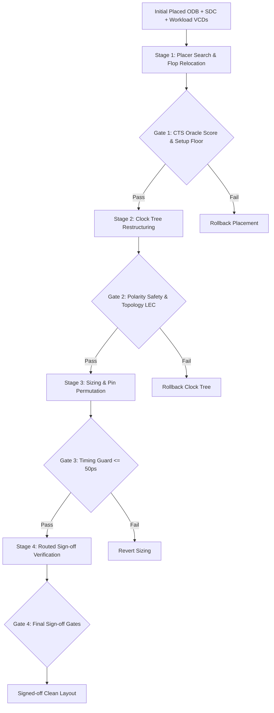

# CL-OVPS: Clock-Logic OpenROAD Power Sign-off

[](https://github.com/Shyam-SN/cl-ovps/actions/workflows/verify.yml)
[](LICENSE)
[](pyproject.toml)

CL-OVPS is an automated, 4-stage physical-design flow integrated with OpenROAD and OpenROAD Flow Scripts (ORFS) that systematically minimizes post-route dynamic clock-network and cell switching power while strictly maintaining design functionality, timing closure, routing legality, and power-grid integrity. Clock distribution networks and flip-flop clock pins frequently account for 30–50% of total chip dynamic power. CL-OVPS addresses this through layout-informed placement screening, topological clock-tree restructuring, and timing-bounded cell sizing, enforcing independent verification (OpenSTA with extracted SPEF and gate-level VCD activity, Yosys logical equivalence checking, and PSM power-grid analysis) at every stage.

---

## Measured Sign-off Results

All values below represent **post-detailed-route dynamic power** (internal cell power plus net switching power), measured with **OpenSTA** using extracted **SPEF** parasitics and matched **gate-level VCD simulation activity**. Zero estimates are presented as sign-off. All percentages are computed directly from unrounded raw watt values in the signed manifests and rounded to two decimal places.

### Primary Results (SkyWater Sky130HD)

| Design | PDK | Clock | Run Type | Idle Dyn. Red. (Abs / %) | Typical Dyn. Red. (Abs / %) | Peak Dyn. Red. (Abs / %) | Setup Δ (WNS) | Hold Δ | DRC / Ant. | PDN (VDD/VSS) | VCD Missing | LEC (Yosys) | Evidence |
|---|---|---|---|---|---|---|---|---|---|---|---|---|---|
| **GCD** | Sky130HD | 20.0 ns | **Cold run** | −24.45 µW (−18.02%) | **−24.68 µW (−16.37%)** | −26.31 µW (−10.96%) | +216.30 ps | −3.95 ps | 0 / 0 | PASS (0 PSM) | 0 (100%) | **52/52** | [Folder](evidence/gcd/gcd_cold/) |
| **AES** | Sky130HD | 3.8 ns | **Replay** | −6.253 mW (−37.73%) | **−6.056 mW (−7.99%)** | **−6.029 mW (−7.81%)*** | +43.84 ps | −1.17 ps | 0 / 0 | PASS (0 PSM) | 0 (100%) | **562/562** | [Folder](evidence/aes/aes_graph_smoke/) |
| **RISCV32I** | Sky130HD | 7.0 ns | **Replay** | −3.255 mW (−25.32%) | **−3.260 mW (−17.65%)** | −3.252 mW (−13.60%) | −3.56 ps | +14.05 ps | 0 / 0 | PASS (0 PSM) | 0 (100%) | **1123/1123** | [Folder](evidence/riscv32i/riscv_graph_smoke/) |

*\*Note on AES Peak Precision*: In `reports/CL_OVPS_FINAL_CLOSEOUT.md`, the AES peak reduction was listed as 7.82% due to historical display rounding; recomputing directly from the unrounded manifest watt values (−0.006028837 W / 0.077146556 W) yields **−7.81%** under standard two-decimal precision.

*Notes on Run Types*:
- **Cold run** (`gcd_cold`): Full end-to-end flow execution starting from raw placed ODB through Stage 1, 2, 3, detailed routing, and final sign-off.
- **Measurement-only replay** (`aes_graph_smoke`, `riscv_graph_smoke`, `timing_floor_replay`): Reopening the final routed candidate ODB, extracted SPEF, SDC, and workload VCDs to re-measure all metrics without re-running optimization.
- **Setup Δ**: Positive indicates slack improvement (e.g., AES setup slack recovered from −41.95 ps to **+1.89 ps**, achieving timing closure). RISCV32I setup delta (−3.56 ps) stayed well within the strict ≤50 ps regression guard.

### Experimental Platform Result (ASAP7 7nm Predictive PDK)

Evaluated under Phase 3A multi-threshold voltage ($V_t$) in-place optimization. 
- **Boundary condition**: Evaluated on a **matched same-route checkpoint with no re-route** after the $V_t$ swaps. Matched standard cell layout dimensions and pin geometry preserve the existing detailed route; signal and special net sections in DEF are byte-identical.
- **Power scope**: Power values are **dynamic power only** (cell internal plus net switching). Static leakage power is evaluated and reported separately.

| Design | PDK | Clock | Run Type | Idle Dyn. Red. (Abs / %) | Typical Dyn. Red. (Abs / %) | Peak Dyn. Red. (Abs / %) | Leakage Δ (Typ) | Setup Δ | DRC / Ant. | PDN | LEC (Yosys) | Evidence |
|---|---|---|---|---|---|---|---|---|---|---|---|---|
| **GCD** | ASAP7 | 500 ps | **Same-route replay (no re-route)** | −0.0048 µW (−0.0033%) | **−1.088 µW (−0.42%)** | −2.152 µW (−0.53%) | −37.661 nW | +0.17 ps | 0 / 0 (inherited) | PASS | **331/331** | [Folder](evidence/asap7_gcd/phase3a_asap7_gcd_500ps/) |

---

## Flow Architecture

CL-OVPS executes four progressive stages. Every candidate mutation is subject to an automated acceptance gate before proceeding to the next stage:



### Stage Responsibilities and Acceptance Gates
1. **Stage 1 (Placement Search)**: Identifies high-activity register clusters and screens legal row relocations. Evaluated using a fast Tier 1 CTS trial oracle (scoring total clock-cell internal power) and HPWL bounds.
   - *Gate*: Trial clock power must be non-increasing; setup slack must not drop below zero if baseline was timing-closed.
2. **Stage 2 (Clock Restructuring)**: Eliminates dummy balancing loads, replaces redundant clock buffers with high-efficiency inverters, and matches clock tree topologies.
   - *Gate*: Dynamic polarity verification (even inverter depths or differential clock sink inversion), leaf-clock non-default routing (NDR) preservation, and pre-route LEC.
3. **Stage 3 (Sizing and Permutation)**: Performs Liberty-checked non-increasing capacitance driver sizing and symmetric pin permutations on data/clock pins.
   - *Gate*: Per-instance timing slack margins and a strict ≤50 ps setup/hold regression threshold.
4. **Stage 4 (Sign-off Verification)**: Detailed global and detailed routing (TritonRoute), RC extraction (OpenRCX), gate-level VCD playback in OpenSTA, DRC/antenna verification, and power-grid analysis.
   - *Gate*: 100% VCD pin coverage, zero DRC violations, zero antenna violations, PSM VDD/VSS connectivity verified, and 100% proven LEC points.

---

## Evidence Verification & Reproducibility

Reviewers can verify every claim in this repository **in under 5 seconds without installing OpenROAD, Yosys, or PDKs**.

### How Claims are Verified
Every metric is cross-checked against physical design outputs:
- **Sign-off Power vs. Estimates**: Derived strictly using OpenSTA with extracted SPEF parasitics and full gate-level VCD simulation activity, eliminating pre-route RC and toggle rate estimation errors.
- **Functionality vs. Corrupted Logic**: Verified using a Yosys logical equivalence checking (LEC) flow (`equiv_make`, `equiv_simple`, `equiv_induct`) with an `async2sync` reset abstraction and gate-level differential simulation.
- **Electrical & Physical Legality**: Verified with OpenROAD detailed route DRC checks, antenna net/pin ratio audits, and PDN connectivity (`check_power_grid` for VDD and VSS with PSM-0069 count = 0).
- **Timing Closure**: Setup and hold slack deltas checked per workload against the strict ≤50 ps regression guard.

### Running the Verification Script

```bash
# Clone the repository
git clone https://github.com/Shyam-SN/cl-ovps.git
cd cl-ovps

# Run offline evidence consistency check (zero external EDA tools required)
python3 scripts/verify_results.py
```

The script:
1. Validates the SHA-256 integrity of all evidence files in [`evidence/SHA256SUMS`](evidence/SHA256SUMS).
2. Re-derives all headline power deltas, percentages, and timing slacks directly from raw OpenSTA quantities in the signed manifests.
3. Checks every derived number against this README, failing if any discrepancy exists.

To run the unit test suite:
```bash
pytest -v
```

---

## Engineering Challenges ("What Was Hard")

Real physical design flows encounter complex nonlinear interactions between layout, parasitics, and timing:
- **Dummy-Only CTS Scoring Misranked Layouts**: Early placer optimization scored candidates solely by dummy buffer load reduction. However, active clock buffer internal power dynamic shifts frequently offset dummy load savings. The scorer was replaced with a total-clock-cell internal power oracle that accurately predicted routed CTS dynamic power.
- **Clock-Tree Polarity and Datapath Buffer Hazards**: Replacing clock buffers with inverters required strict graph-traversal polarity tracking to prevent inverted flip-flop clocking. Furthermore, CTS restructuring had to explicitly filter out datapath buffers located near clock pins that shared cell naming patterns.
- **Power-Grid Macro Overlaps (`xor3` Anomaly)**: During AES Stage 3 sizing, candidate master `sky130_fd_sc_hd__xor3_4` overlapped a macro routing blockage and severed PSM VDD/VSS rail connectivity; candidate `sky130_fd_sc_hd__xor3_1` suffered a 30 ps setup regression; candidate `sky130_fd_sc_hd__xor3_2` successfully passed both PSM connectivity and timing closure (+43.8 ps setup recovery).
- **Retirement of Tier 2 Pre-Route Switching Prediction**: A machine-learned / analytical pre-route switching power predictor (Tier 2) achieved high training correlation on PicoRV32 but failed to generalize on held-out GCD designs (MAE 105.97 nW vs zero-change 367.44 nW, with 0 timing-clean power reductions). In keeping with our credibility-first methodology, Tier 2 was formally retired.

---

## Negative Results and Non-Promoted Experiments

We document experimental passes that were evaluated and rejected:
1. **Phase 3B Integrated Clock Gating (ICG)**:
   - Evaluated on GCD with 1 inserted `sky130_fd_sc_hd__dlclkp_1` (4 sinks).
   - **Result**: Dynamic power **worsened** across all workloads (Idle: **+41.115 µW** [+36.98%], Typical: **+37.434 µW** [+29.69%], Peak: **+29.980 µW** [+14.03%]), and setup slack regressed by **−352.88 ps** (violating the 50 ps guard).
   - On AES and RISCV32I, zero clusters met the synchronous single-clock domain proofs and clustering diameter limits. Phase 3B was formally rejected. Detailed in [`reports/CL_OVPS_PHASE3B_ICG_REPORT.md`](reports/CL_OVPS_PHASE3B_ICG_REPORT.md).
2. **Phase 2 Empirical Ablation (Passes 3C, 3D, 3E)**:
   - Pass 3C (Liberty-gated sequential cell sizing) found zero qualifying instances with strictly non-increasing pin capacitance.
   - Pass 3D (Complex gate folding) found zero accepted substitutions on GCD/AES/RISCV32I under physical/timing constraints.
   - Pass 3E (Arrival skew / glitch alignment) produced diagnostic SDF arrival data, but matched SDF/zero-delay gate VCD pairs were unavailable.
   - All three passes resulted in identity ablations (0.00% incremental gain) and were not promoted. Detailed in [`reports/CL_OVPS_PHASE2_ABLATION_REPORT.md`](reports/CL_OVPS_PHASE2_ABLATION_REPORT.md).

---

## Limitations & Scope
- **Benchmark Coverage**: Validated on three flat, single-domain Sky130HD designs (GCD, AES, RISCV32I) and one ASAP7 experimental design. Not yet validated on arbitrary commercial PDKs or multi-voltage UPF designs.
- **Clock Domain Complexity**: Does not currently handle asynchronous clock domain crossings, generated clocks, or analog PLL feedback loops.
- **LEC Reset Abstraction**: Logical equivalence checking uses Yosys with an `async2sync` reset abstraction on sequential cells to establish functional equivalence across clock restructuring. It is not an ASIC commercial sign-off LEC replacement.
- **ASAP7 Boundary**: The ASAP7 multi-$V_t$ result represents in-place cell swapping on an existing route; full re-routing was not performed.

---

## Project Structure

```
.
├── evidence/                  # Whitelisted small sign-off evidence (< 1 MB)
│   ├── SHA256SUMS             # Checksums for all committed evidence
│   ├── PROVENANCE.tsv         # Maps evidence files to original build/ hashes
│   ├── NORMALIZATION_DIFF.patch # Verifies only paths were normalized
│   ├── gcd/gcd_cold/          # GCD cold-run manifests, logs, SDC
│   ├── aes/aes_graph_smoke/   # AES sign-off manifests, logs, SDC
│   ├── riscv32i/              # RISCV32I manifests, logs, SDC
│   ├── asap7_gcd/             # ASAP7 multi-Vt sign-off manifests
│   └── ablation/              # Phase 3B ICG and Phase 2 ablation evidence
├── scripts/
│   ├── verify_results.py      # Independent verification CLI (no EDA tools needed)
│   ├── run_cl_ovps_*.py       # Core 4-stage flow runners
│   └── README.md              # Complete catalog of all 185 scripts
├── configs/                   # SDC timing constraints and flow templates
├── designs/                   # Source RTL and simulation testbenches (AES, GCD, PicoRV32)
├── docs/
│   ├── ENVIRONMENT.md         # Pinned tool commits, compiler flags, and system specs
│   └── METHODOLOGY.md         # Power definitions, VCD generation, timing rules
├── reports/                   # Authoritative closeout and ablation technical reports
├── web/                       # Local static power comparison visualizer
├── versions.lock              # Pinned Git SHAs for OpenROAD, ORFS, Yosys, PDKs
└── pyproject.toml             # Python >=3.14 project definition and dependencies
```

---

## License & Attribution

- CL-OVPS software and scripts are licensed under the **BSD 3-Clause License** ([`LICENSE`](LICENSE)).
- Third-party designs, toolchains, and benchmarks retain their original upstream licences: PicoRV32 (ISC Licence, Claire Wolf), GCD (BSD-3-Clause, OpenROAD / PyMTL), and AES (Permissive BSD-style, Rudolf Usselmann / OpenCores). Complete legal details and upstream URLs are documented in [`THIRD_PARTY.md`](THIRD_PARTY.md).
